<div align="center">

<picture>
  <source media="(prefers-color-scheme: dark)" srcset=".github/assets/banner-dark.svg">
  
</picture>

**A production Laravel sync endpoint that remains independent from every mobile SDK.**<br>
Serve the stable integer-coded sync protocol to PAM Native, web, desktop or any other client with validated requests, transactional services, repositories and typed resources.

[](https://packagist.org/packages/pushinbr/pam-native-sync-laravel)
[](https://github.com/push-in/pam-native-sync-laravel/releases/latest)

[](https://github.com/push-in/pam-native-sync-laravel/actions/workflows/ci.yml)
[](LICENSE)

[Install](#install) · [Quick example](#quick-example) · [Configuration](#requirements) · [Protocol](#protocol) · [Docs](#docs) · [Issues](https://github.com/push-in/pam-native-sync-laravel/issues)

</div>

<a id="install"></a>
## <picture></picture> Install

Install it only in the Laravel backend (Laravel 12 or 13, PHP 8.5). On a PAM-served Laravel app (`pam init my-api --template laravel`):

```sh
pam composer require pushinbr/pam-native-sync-laravel
php artisan vendor:publish --tag=pam-native-sync-config
php artisan migrate
```

The package is an ordinary Laravel Composer package: it does not require PAM, PAM HTTP, PAM Native or the mobile sync client, so frontend and backend are installed, upgraded, tested and deployed independently. The service provider is auto-discovered. The mobile application separately installs whichever sync client it chooses; [`pushinbr/pam-native-sync`](https://github.com/push-in/pam-native-sync) is one compatible client, not a server dependency.

<a id="quick-example"></a>
## <picture></picture> Quick example

Register an explicit handler for every synchronized collection:

```php
use Pam\Native\LaravelSync\Contracts\SyncCollectionHandler;
use Pam\Native\LaravelSync\Domain\AppliedChange;
use Pam\Native\LaravelSync\Domain\IncomingOperation;
use Pam\Native\LaravelSync\Domain\SyncConflictException;
use Pam\Native\LaravelSync\SyncCollectionRegistry;

final class NotesSyncHandler implements SyncCollectionHandler
{
    public function collection(): string
    {
        return 'notes';
    }

    public function apply(string $subjectIdentifier, IncomingOperation $operation): AppliedChange
    {
        // Persist the change for $subjectIdentifier, or reject it:
        // throw new SyncConflictException('Version conflict.');

        return new AppliedChange(
            'notes',
            $operation->recordIdentifier,
            $operation->kind,
            $operation->payload,
            $operation->baseVersion + 1,
            (int) floor(microtime(true) * 1000),
        );
    }
}

// AppServiceProvider::boot()
$this->app->make(SyncCollectionRegistry::class)->register(new NotesSyncHandler());
```

On the device, a PAM Native app talks to the endpoint through `pam-native-sync` (in its own repository and process):

```php
$engine = new SyncEngine($store, new HttpSyncTransport(
    endpoint: $baseUrl.'/pam-native/sync',
    clientIdentifier: $deviceId,
    tokenProvider: fn (): ?string => $token,
));
$engine->synchronize(fn (SyncRunReport $report) => updateSyncStatus($report));
```

<a id="platform-support"></a>
## <picture></picture> Platform support

| Platform | Support | Notes |
| --- | --- | --- |
| Laravel | 12, 13 | `illuminate/*` ^12.0 or ^13.0 |
| PHP | 8.5+ | From `composer.json` |
| Clients | Any | PAM Native, web, desktop or any client that speaks the protocol |

<a id="requirements"></a>
## <picture></picture> Configuration and production rules

`config/pam-native-sync.php` defaults:

| Key | Default |
| --- | --- |
| `path` | `pam-native/sync` (one `POST` route, `pam-native.sync`) |
| `middleware` | `api`, `auth:sanctum`, `throttle:60,1` |
| `max_operations` | `100` |
| `max_pull` | `500` |
| `cursor_key` | `env('APP_KEY')` |
| `retention_days` | `30` |

- Protect the supplied route with your authentication middleware.
- Register an explicit handler for every synchronized collection.
- Keep the HMAC cursor key stable across deploys.
- Cursor payloads are signed and bounded but are **not encrypted**; never place secrets inside cursor state.

<a id="what-you-can-build"></a>
## <picture></picture> What you can build

- Mobile-to-Laravel offline synchronization
- Server-issued cursors and incremental change feeds
- Central conflict policy and idempotent mutation handling

| | |
| --- | --- |
| **Best for** | A Laravel backend serving offline-capable clients |
| **Server path** | Form Request → service → repository → API Resources |
| **Application model** | Ordinary Laravel Composer package |
| **Design rule** | Wire-compatible but dependency-independent from every frontend |

<a id="protocol"></a>
## <picture></picture> Protocol

The server provides authenticated incremental pulls, idempotent mutation ingestion, HMAC-signed cursors, conflict responses, collection registration and retention boundaries. Its JSON protocol uses sequential integer enums and does not expose PHP class names or framework-specific objects.

<a id="testing"></a>
## <picture></picture> Testing

The integration suite boots a real Testbench application and verifies push idempotency, pull cursors, validation, resources and conflict flow (`tests/SyncEndpointTest.php`, `tests/PackageBoundaryTest.php`).

<a id="docs"></a>
## <picture></picture> Docs

- [PAM Native Sync (client)](https://github.com/push-in/pam-native-sync)
- [PAM Native overview](https://push-in.github.io/pam-docs/native/overview/)
- [Changelog](CHANGELOG.md)
- [Report an issue](https://github.com/push-in/pam-native-sync-laravel/issues)

<a id="pam-ecosystem"></a>
## <picture></picture> Part of the PAM ecosystem

<p align="center"><picture>
  <source media="(prefers-color-scheme: dark)" srcset=".github/assets/pam-wordmark-dark.svg">
  
</picture></p>

PAM runs PHP natively on servers, desktops and phones. This repository is the Laravel server side of PAM Native Sync.

| [**PAM**](https://github.com/push-in/pam) | [**PAM Desktop**](https://github.com/push-in/pam-desktop) | [**PAM Native**](https://github.com/push-in/pam-native) | [**Ecosystem**](https://github.com/push-in/pam#ecosystem) |
| --- | --- | --- | --- |
| the runtime and CLI | native desktop apps in PHP | native Android and iOS apps in PHP | every official package and plugin |

<sub>Docs: [push-in.github.io/pam-docs](https://push-in.github.io/pam-docs/introduction/) · [Issues](https://github.com/push-in/pam-native-sync-laravel/issues)</sub>

<p align="center"><sub><a href="LICENSE">Apache License 2.0</a> · Made in Brazil by Pushin</sub></p>
